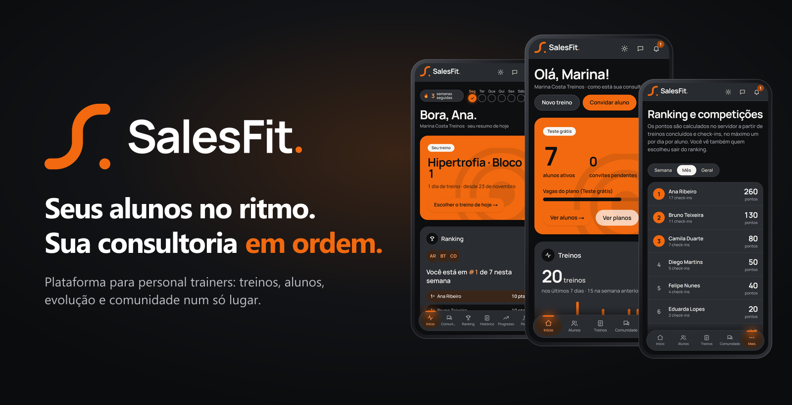
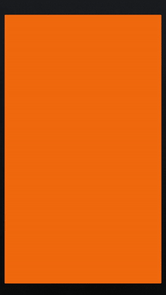
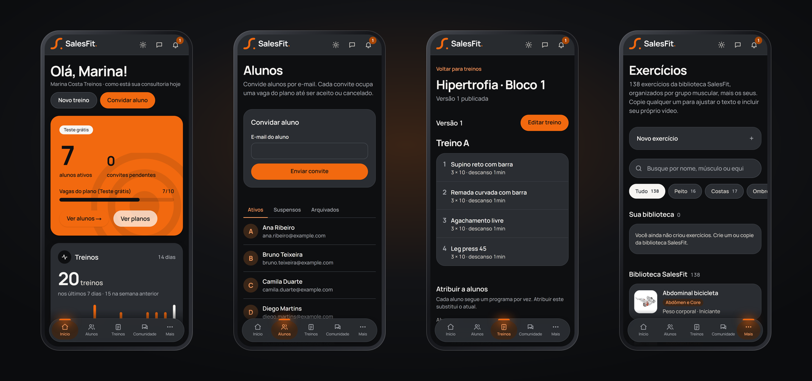
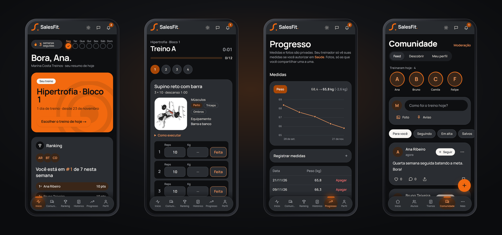
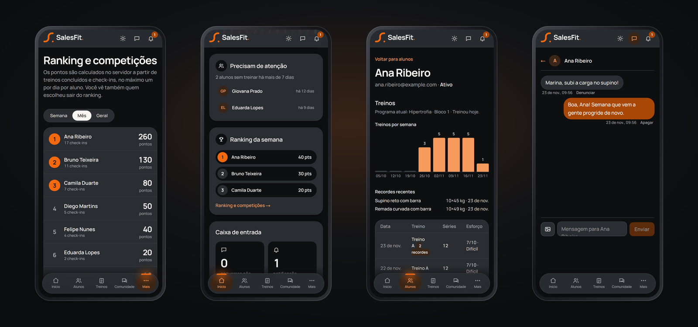
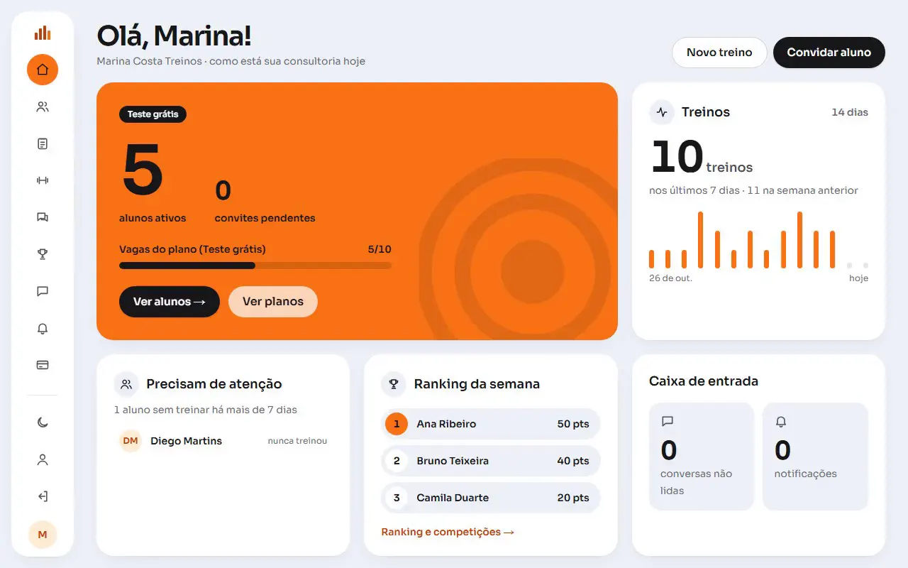
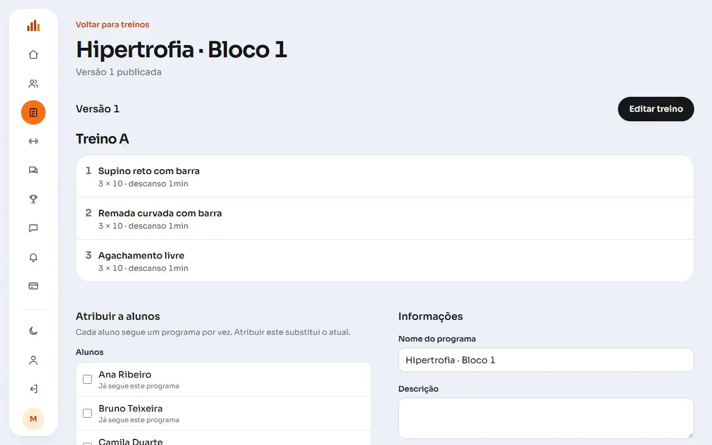

  

<h1 align="center">SalesFit</h1>

  <strong>Plataforma para personal trainers acompanharem seus alunos: treinos, evolução, constância e comunidade em um só lugar.</strong>

  
  
  
  
  
  
  
  
  

  <a href="https://web-production-329fe.up.railway.app"><strong>Ver o app no ar</strong></a>

---

## O problema

Muitos personal trainers que atendem online ainda organizam a consultoria em planilha e WhatsApp. O treino se perde na conversa, ninguém registra a evolução e o aluno que para de treinar só é percebido quando cancela.

O **SalesFit** junta tudo num app só: o treinador monta os treinos e vê na hora quem precisa de atenção, e o aluno treina pelo celular, registra a evolução e é incentivado pela comunidade e pelo ranking.

## Anúncio

<!-- Para o vídeo tocar aqui: edite este README no GitHub, apague esta linha e arraste o arquivo assets/anuncio.mp4 para o editor. O GitHub troca pelo player. -->

Anúncio de 32 segundos feito em código com **Remotion**, usando as telas reais do app: [assets/anuncio.mp4](assets/anuncio.mp4)

## Telas

**Treinador:** painel, alunos, montagem de treinos e biblioteca de exercícios.

**Aluno:** início com a sequência da semana, treino guiado, progresso e comunidade.

**Engajamento:** ranking, alerta de quem parou de treinar, histórico do aluno e mensagens.

**No computador**

 

## Funcionalidades

**Para o treinador**
- Painel com alunos ativos, treinos da semana e quem está há mais de 7 dias sem treinar.
- Convite de alunos por e-mail.
- Programas de treino por dias, com versões publicadas e histórico.
- Biblioteca com 138 exercícios, demonstrações animadas e vídeos próprios.
- Ranking por pontos de constância e competições com período e prêmio.
- Comunidade com feed, curtidas, comentários, perfis e moderação.
- Mensagens em tempo real e notificações no celular.
- Planos com teste grátis de 7 dias e assinatura recorrente.

**Para o aluno**
- Ficha de treino e treino guiado, com séries, carga e descanso.
- Check-in diário e sequência de semanas com a meta batida.
- Histórico de treinos e recordes pessoais.
- Peso, medidas e fotos de progresso, privados por padrão.
- Comunidade, ranking e conversa direta com o treinador.

**Plataforma**
- PWA instalável, com tema claro e escuro e animações que respeitam a preferência de menos movimento.
- Português, inglês e espanhol.
- Verificação em duas etapas, exportação e exclusão de dados (LGPD).
- Várias consultorias no mesmo sistema, isoladas no banco de dados.

## Stack

| Camada | Tecnologias |
|---|---|
| Front-end | Next.js 16 (App Router, Server Components), React 19, TypeScript, Tailwind CSS 4, GSAP, View Transitions |
| Back-end | Server Actions, PostgreSQL com Drizzle ORM e Row Level Security, Redis, armazenamento S3 |
| Tempo real | Server-Sent Events para mensagens, Web Push para notificações |
| Pagamentos | Asaas (Pix, boleto e cartão, com webhooks verificados) |
| Qualidade | Vitest, Playwright com testes de acessibilidade (axe, WCAG 2.2 AA), GitHub Actions |
| Infra | Docker, Railway |
| Vídeo | Remotion |

## Destaques técnicos

- **Isolamento por consultoria no banco:** cada consulta roda com o contexto da consultoria, e políticas de Row Level Security no PostgreSQL impedem ver dados de outra.
- **Acessibilidade testada:** cerca de 30 telas passam por verificação automática de contraste e acessibilidade nos temas claro e escuro, a cada mudança.
- **Testes:** mais de 250 testes unitários e de integração e mais de 30 fluxos de ponta a ponta no navegador.
- **Animações:** transições de página com View Transitions nativas, sem biblioteca extra.
- **Segurança:** senhas com Argon2, limite de tentativas no Redis, cabeçalhos de segurança com CSP e verificação em duas etapas obrigatória para administradores.

---

<em>Código-fonte privado. Acesso disponível sob solicitação para recrutadores.</em>

